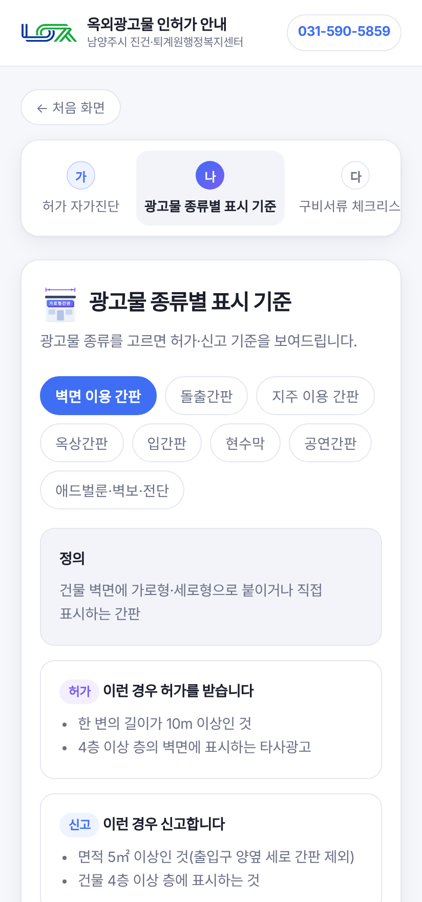
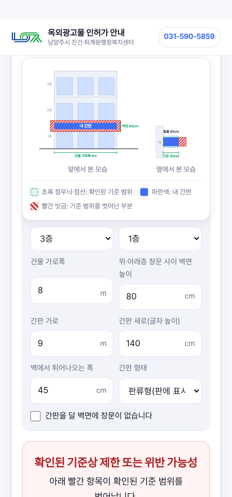
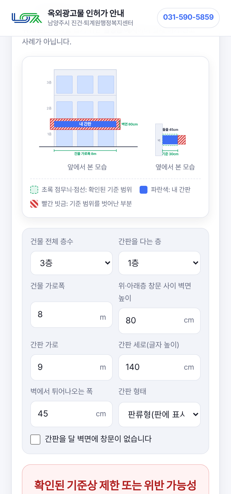
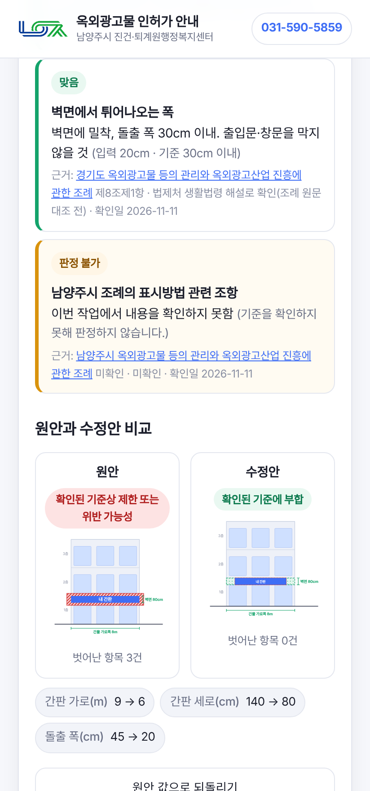
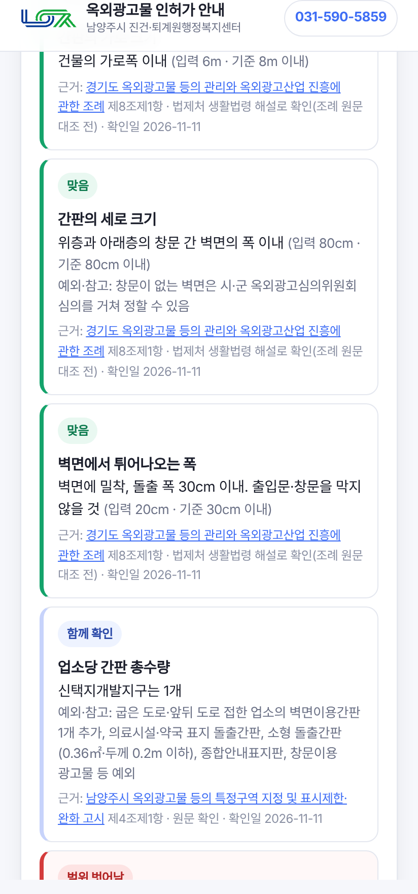
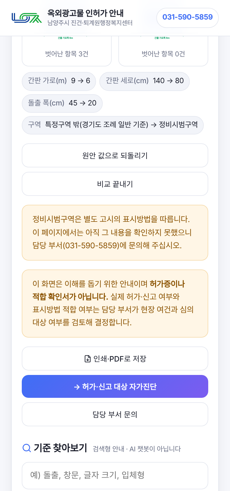

# 개선 전후 비교

- 개선 전: 저장소 커밋 97f23b6(2026-11-04 배포본)을 로컬에서 띄워 캡처
- 개선 후: 이번 작업본을 로컬에서 띄워 캡처(2026-11-11, **배포 전**)
- 캡처 조건: 휴대폰 화면 412×880

## 1. 첫 화면

| 개선 전 | 개선 후 |
|---|---|
|  |  |
| 주요 버튼: 자가진단 시작 | 주요 버튼 추가: 내 간판 설치기준 알아보기 |

## 2. 표시 기준 안내

| 개선 전 (종류별 표시 기준) | 개선 후 (그림으로 보는 설치기준) |
|---|---|
|  |  |
| 허가·신고 대상만 글로 안내. 세부 수치는 "확인이 필요합니다" | 건물 그림 위에 기준 범위와 내 간판을 표시 |

## 3. 결과와 근거

| 개선 후 |
|---|
|  |
| 판정, 항목별 결과, 근거 조문·검증 상태·확인일 |

## 3-1. 원안·수정안 비교, 구역 변경, 판단 보류

| 원안·수정안 비교 | 구역을 신택지개발지구로 변경 | 정비시범구역(기준 미확인) |
|---|---|---|
|  |  |  |
| 고치기 전후 그림과 결과를 나란히 표시 | 같은 간판도 구역 기준이 더해져 결과가 달라짐 | 확인하지 못한 기준은 판정하지 않음 |

## 4. 측정값

| 항목 | 개선 전 | 개선 후 | 측정 방법 |
|---|---|---|---|
| 표시 기준 화면의 표시방법 수치 | 0건 | 규칙 26건 | 화면 본문·데이터 파일 확인 |
| 기준 설명 그림 | 0개 | 2종(벽면: 앞·옆 모습, 돌출: 앞 모습) | 화면 요소 수 |
| 입력란 | 0개 | 벽면 9개, 돌출 8개 | 화면 요소 수 |
| 규칙별 근거 링크·확인일 | 없음 | 전 항목 | 자동 점검 |
| 첫 화면에서 기준 그림까지 누르는 횟수 | 해당 기능 없음 | 1회 | 화면 조작 |
| 자동 점검 | 0건 | 63건 통과 | `tests/site.test.js` |
| 기준 변경 시 고칠 곳 | index.html 코드 | `data/regulations.json` | 구조 비교 |

## 5. 측정하지 않은 항목 (예상 효과)

- 민원인이 기준을 이해하는 데 걸리는 시간
- 주요 시나리오 완료율
- 착오 접수·보완 요구·전화 문의 변화

시범운영 기간에 상담 기록으로 측정할 계획이며, 현재는 수치가 없습니다.
